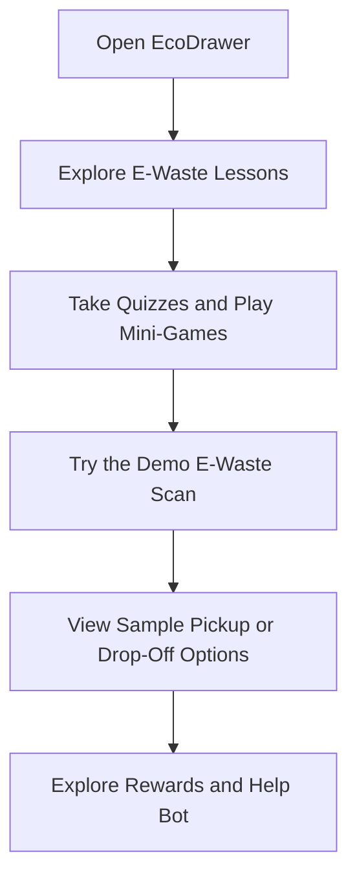

# EcoDrawer

EcoDrawer is a small e-waste awareness demo built during **TechnoCycle 26** in approximately **2 hours**, with the help of **Claude AI**.

## Problem

Many people are unaware of how to dispose of electronic waste responsibly or where to start. This can lead to e-waste being discarded with regular household waste.

## Solution

EcoDrawer provides a simple interactive platform to introduce responsible e-waste practices through short lessons, quizzes, mini-games, and a demo pickup flow.

## Process Flow



## Features

- E-waste awareness lessons and quizzes
- Mini-games for learning about e-waste
- Demo e-waste photo scan
- Sample pickup/drop-off booking flow
- Rewards and a simple help bot
- English and Tamil interface

## Tech Stack

- React
- TypeScript
- Vite
- HTML & CSS
- Local Storage

## Run Locally

```bash
git clone https://github.com/VGSAIRAIMA/EcoDrawer.git
cd EcoDrawer
npm install
npm run dev
```

## Links

- **Live Demo:** https://eco-drawer.vercel.app/
- **GitHub:** https://github.com/VGSAIRAIMA/EcoDrawer

## Note

This is a hackathon prototype. Scanning, bookings, and the help bot are demo features and are not connected to live external services.
